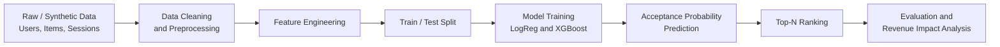
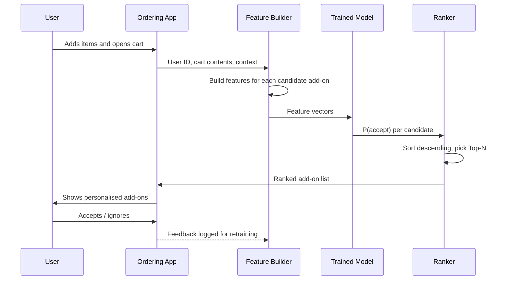
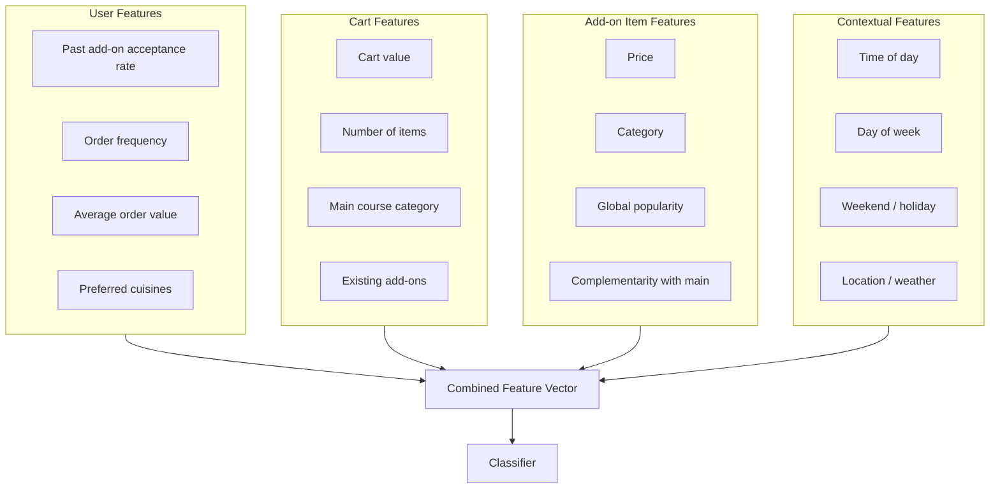
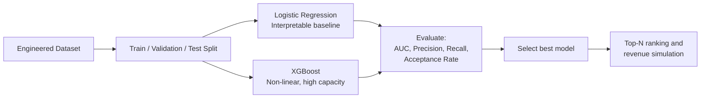
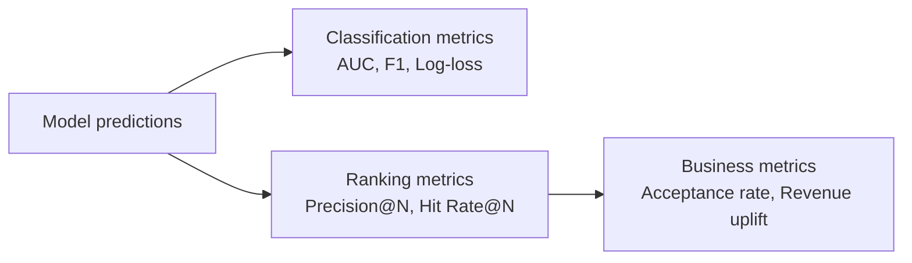

<div align="center">

# 🛒 SmartCart AI

### Context-Aware Add-On Recommendation System

*Predicting which food add-ons a customer is most likely to accept, at the right moment in the ordering journey.*


</div>

---

## 📑 Table of Contents

1. [Overview](#-overview)
2. [Problem Statement](#-problem-statement)
3. [Solution](#-solution)
4. [Key Results](#-key-results)
5. [Features](#-features)
6. [System Architecture](#-system-architecture)
7. [Theory and Concepts](#-theory-and-concepts)
8. [Models](#-models)
9. [Evaluation Methodology](#-evaluation-methodology)
10. [Revenue Impact Analysis](#-revenue-impact-analysis)
11. [Tech Stack](#-tech-stack)
12. [Repository Structure](#-repository-structure)
13. [Getting Started](#-getting-started)
14. [Limitations](#-limitations)
15. [Future Work](#-future-work)
16. [Contributing](#-contributing)
17. [Author](#-author)

---

## 🔎 Overview

**SmartCart AI** is a machine learning based recommendation engine built during **Zomathon 2026**. At the cart stage of a food order, it predicts which **add-on items** (sides, drinks, desserts, breads, dips and so on) a specific user is most likely to accept, then ranks them so the best few are shown first.

Unlike a generic "popular items" widget, SmartCart AI is **context-aware**. It takes into account *who* the user is, *what* is already in the cart, and *when and where* the order is happening.

---

## ❗ Problem Statement

Customers often miss relevant add-on items while ordering food. This leads to:

- **Lost revenue** for restaurants and the platform (lower average order value).
- **Poor customer experience**, for example ordering a biryani and forgetting a raita or a drink.
- **Irrelevant suggestions** when recommendations are static, non-personalised, or ignore the cart.

The core question: *given a user and their current cart, which add-ons should we show, and in what order, to maximise acceptance?*

---

## 💡 Solution

SmartCart AI frames the task as a **binary classification + ranking** problem:

1. For every `(user, cart, candidate add-on)` triple, predict the **probability of acceptance**.
2. Sort candidate add-ons by predicted probability.
3. Display the **Top-N** add-ons to the user.

Two models are trained and compared: an interpretable baseline (**Logistic Regression**) and a high-performance gradient boosted model (**XGBoost**).

---

## 📈 Key Results

| Metric | Baseline | SmartCart AI |
|---|:---:|:---:|
| **Add-on acceptance rate** | 29.6% | **60.3%** |
| **Estimated revenue uplift** | n/a | **₹3.68 Lakhs per 10,000 sessions** |

- Acceptance improved by about **30.7 percentage points**, roughly a **2x relative increase**.
- ₹3.68 Lakhs over 10,000 sessions works out to about **₹36.8 additional revenue per session**.

> ⚠️ **Note:** These numbers are produced on a **synthetic dataset** (see [Limitations](#-limitations)). They demonstrate the approach and pipeline, and should be validated on real production data before being treated as expected business impact.

---

## ✨ Features

- 🧪 **Synthetic dataset generation**: realistic session, user, and item data for experimentation.
- 🛠️ **Feature engineering**: user, cart, item, and contextual features.
- 👤 **User behavior modeling**: captures individual add-on preferences and order history.
- 🏆 **Top-N recommendation ranking**: ranks add-ons by predicted acceptance probability.
- 💰 **Revenue impact analysis**: converts model performance into estimated business value.
- 📊 **Model comparison**: Logistic Regression baseline vs XGBoost.

---

## 🏗️ System Architecture

### 1. High-Level Pipeline



### 2. Real-Time Recommendation Flow

How the system behaves at the moment a user reaches the cart:



### 3. Feature Engineering Layers



> The feature names above are the intended feature groups. See the notebooks in [`Smartcart_AI/data/notebooks`](./Smartcart_AI/data/notebooks) for the exact columns used.

### 4. Model Training and Selection



---

## 📚 Theory and Concepts

### 1. Recommender Systems: Where Add-Ons Fit

Recommender systems typically fall into these families:

| Approach | Idea | Limitation for add-ons |
|---|---|---|
| **Popularity-based** | Show globally popular items | Ignores user and cart |
| **Collaborative filtering** | Users with similar history like similar items | Cold-start; ignores live cart context |
| **Content-based** | Recommend items similar to what the user liked | Limited discovery |
| **Context-aware / feature-based ML** *(this project)* | Learn `P(accept ∣ user, cart, item, context)` | Needs good features and data |

Add-on recommendation is a **cart-level, session-based** problem. The decision depends heavily on the current cart (a pizza strongly implies garlic bread or a cold drink), which is why a **context-aware supervised learning** approach fits well.

### 2. Problem Formulation

For each session `s` and candidate add-on `i`:

```
x(s, i) = [ user features, cart features, item features, context features ]
y(s, i) = 1 if the user accepted add-on i in session s, else 0
```

The model learns:

```
P(y = 1 | x) = f(x)
```

At inference, candidates are sorted by `f(x)` and the **Top-N** are shown. This is the **pointwise learning-to-rank** approach: score each item independently, then sort.

### 3. Logistic Regression (Baseline)

Models acceptance probability as a linear function passed through a sigmoid:

```
P(y = 1 | x) = 1 / (1 + e^-(w·x + b))
```

- Trained by minimising **log-loss (binary cross-entropy)**.
- **Strengths:** fast, interpretable coefficients, strong baseline, well-calibrated probabilities.
- **Weakness:** cannot capture feature interactions (e.g. *"dessert add-on matters more on weekend evenings for high-value carts"*) without manual feature crossing.

### 4. XGBoost (Gradient Boosted Trees)

An ensemble of decision trees built **sequentially**, where each new tree corrects the errors of the previous ones:

```
ŷ = Σ f_k(x),   f_k ∈ space of trees
```

- Optimises a regularised objective: `Loss + Ω(trees)`, which penalises complexity to reduce overfitting.
- **Strengths:** captures **non-linear relationships and feature interactions** automatically, handles mixed feature types, robust on tabular data.
- **Weakness:** less interpretable than Logistic Regression and needs tuning (depth, learning rate, number of trees).

### 5. Feature Engineering Rationale

| Feature group | Why it matters |
|---|---|
| **User behavior** | Past acceptance rate is one of the strongest predictors of future acceptance |
| **Cart composition** | The main dish determines which add-ons are *complementary* |
| **Item attributes** | Price sensitivity: cheap add-ons are accepted far more easily |
| **Context** | Time and day shift demand (cold drinks in summer, desserts on weekends) |

### 6. Top-N Ranking

Showing every candidate is not practical because screen space is limited. The system keeps only the `N` highest-probability add-ons. Quality here is measured with ranking-aware metrics (Precision@N, Recall@N, Hit Rate@N), not just overall accuracy.

### 7. Handling Class Imbalance

Most add-on impressions are **not** accepted, so the positive class is the minority. Common remedies:

- Class weights (`class_weight` in sklearn, `scale_pos_weight` in XGBoost)
- Threshold tuning instead of the default 0.5
- Evaluating with **ROC-AUC / PR-AUC**, since plain accuracy is misleading

### 8. Why Synthetic Data?

Real order data is proprietary and privacy-sensitive. A synthetic generator allows:

- Controlled simulation of realistic behavior patterns (user preferences, complementary items)
- Reproducible experiments for a hackathon setting
- Safe sharing of the full pipeline without customer data

---

## 🤖 Models

| Model | Role | Strengths | Trade-offs |
|---|---|---|---|
| **Logistic Regression** | Interpretable baseline | Fast, transparent, calibrated | Linear only |
| **XGBoost** | Main predictive model | Non-linear, handles interactions | Harder to explain, needs tuning |

---

## 🧮 Evaluation Methodology

**Classification metrics**

- ROC-AUC and PR-AUC
- Precision, Recall, F1
- Log-loss (probability quality)

**Ranking metrics**

- Precision@N, Recall@N
- Hit Rate@N (did the user accept *at least one* of the shown Top-N?)

**Business metrics**

- **Add-on acceptance rate**: `accepted add-ons / add-ons shown`
- **Revenue uplift**: additional revenue per session versus baseline



---

## 💰 Revenue Impact Analysis

The simulation converts the improvement in acceptance into money:

```
Uplift per session  ≈  (extra accepted add-ons per session) × (average add-on price)
Total uplift        =  Uplift per session × number of sessions
```

| Quantity | Value |
|---|---|
| Sessions simulated | 10,000 |
| Acceptance rate (before → after) | 29.6% → 60.3% |
| **Estimated revenue uplift** | **₹3.68 Lakhs** |
| Implied uplift per session | ≈ ₹36.8 |

---

## 🧰 Tech Stack

| Layer | Tools |
|---|---|
| Language | Python |
| Data handling | Pandas, NumPy |
| Classical ML | Scikit-learn (Logistic Regression, metrics, splits) |
| Boosting | XGBoost |
| Environment | Jupyter Notebooks |

---

## 📁 Repository Structure

```text
SmartCART-ai-recommendation-system/
├── Smartcart_AI/
│   └── data/
│       └── notebooks/        # Data generation, feature engineering, modeling, analysis
└── README.md
```

---

## 🚀 Getting Started

### Prerequisites

- Python 3.9+
- pip
- Jupyter Notebook or JupyterLab

### Installation

```bash
# 1. Clone the repository
git clone https://github.com/vishal-mundewadi/SmartCART-ai-recommendation-system.git
cd SmartCART-ai-recommendation-system

# 2. (Optional) create a virtual environment
python -m venv venv
source venv/bin/activate        # Windows: venv\Scripts\activate

# 3. Install dependencies
pip install pandas numpy scikit-learn xgboost jupyter
```

### Run

```bash
jupyter notebook Smartcart_AI/data/notebooks/
```

Run the notebooks in order:

1. Synthetic data generation
2. Feature engineering
3. Model training (Logistic Regression and XGBoost)
4. Top-N ranking and revenue impact analysis

---

## ⚠️ Limitations

- **Synthetic data:** results reflect the assumptions baked into the data generator and may not transfer directly to real user behavior.
- **Pointwise ranking:** items are scored independently; pairwise or listwise methods may rank better.
- **No exposure bias handling:** real logs only show feedback on items that were previously shown.
- **Offline evaluation only:** no A/B test or live deployment yet.

---

## 🔮 Future Work

- [ ] Validate on real or anonymised production order data
- [ ] Learning-to-rank models (LambdaMART, XGBoost `rank:ndcg`)
- [ ] Deep models and embeddings for users and items
- [ ] Contextual bandits for exploration and exploitation
- [ ] Cold-start handling for new users and new items
- [ ] SHAP-based explainability for recommendations
- [ ] REST API (FastAPI) for real-time serving
- [ ] CI with GitHub Actions (tests and linting)
- [ ] Online A/B testing framework

---

## 🤝 Contributing

Contributions, issues, and feature requests are welcome.

1. Fork the repository
2. Create a feature branch: `git checkout -b feature/your-feature`
3. Commit your changes: `git commit -m "Add your feature"`
4. Push: `git push origin feature/your-feature`
5. Open a Pull Request

---

## 👤 Author

**Vishal Mundewadi**
GitHub: [@vishal-mundewadi](https://github.com/vishal-mundewadi)

---

<div align="center">

⭐ If you found this project useful, consider giving it a star!

</div>
